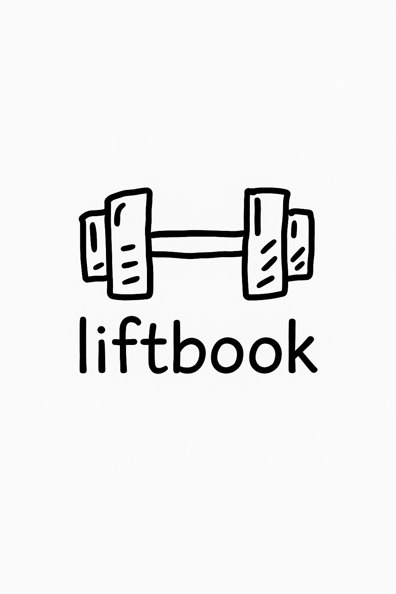

# Liftbook

A weightlifting log for iPhone that's meant to feel like writing in a paper
notebook: type a movement, type your sets, and it quietly tells you what you
did last time. No accounts, no setup, no cloud. On the
[App Store](https://apps.apple.com/us/app/liftbook-strength-log/id6755925820)
as **Liftbook: Strength Log**.

<p align="center">
  
</p>

<p align="center">
  
  
  
  
  
</p>

## Why

I got tired of bloated fitness tracking apps. I wanted something that logs a
set about as fast as I could write it down, and nothing else. It was also my
first go at building a mobile app that actually made it into the App Store.

The pitch on [liftbookapp.com](https://liftbookapp.com) is "as simple as a
notebook," and that's the design constraint the code keeps coming back to:
black and white, a handwritten font, ruled lines, and as little UI between
you and the next set as possible.

The repo started as a copy of the `liftbook` branch of
[jackedTracker](https://github.com/NoahDorfman00/jackedTracker), an earlier
React Native project of mine.

## How it works

### The page

A lift is one notebook page: a date, a title ("Push Day"), and a list of
movements, each with sets of `weight × reps`. Every entry happens in a
single footer that rides on top of the keyboard. Type a title, submit, and
the footer switches to movement names; submit a movement, and it switches
to a two-field weight/reps entry with the number pad. Tap any line on the
page to edit it, long-press to delete it. There's no save button: every
submit writes through to storage.

The editor's focus logic used to be five parallel state variables, four
self-resetting focus flags, and seven refs cleared by staggered
`setTimeout`s. It's now one descriptor (`none | title | movementName | set`)
and a focus-request counter.

### Suggestions

There's no exercise database to pick from. Suggestions come from your own
history (`suggestionEngine.ts`, pure functions with unit tests):

- **Titles** predict your rotation. It finds the most recent lift's title,
  looks back to the previous time you did that same title, and suggests
  whatever you logged in between, in order. If you go Push, Pull, Legs,
  Push, the next suggestion is Pull. After that come all your titles by
  recency, then a short list of defaults.
- **Movements** come first from previous lifts with the same title (most
  recent lift first, in the order you did them), then from any other lift,
  then defaults. Movements already on the current page sink to the bottom.
- **Matching** is word-prefix based: each query word must match the start of
  a different word, so "inc pr" finds "Incline Press".
- **Sets** get no suggestions. Instead, a line under the input reads
  `last time: 135x8, 140x6`, pulled from the most recent earlier lift that
  had this movement.

That last one replaced something cleverer. In late 2025 the app suggested
weights by finding the tightest cluster of your working sets from last time
(to filter out warmups and drop sets) and suggesting values around it. It
was removed when the charts landed in March 2026, and the plain "last time"
note took its place.

Candidate lists are built once per data change; each keystroke just filters
a small precomputed list instead of rescanning every lift, movement and set.

### Charts

The charts screen plots one movement at a time over 1M / 3M / 6M / 1Y / All.
In **weight** mode it draws three lines per day: max, average and min weight
across that day's sets. In **volume** mode it plots `weight × reps` summed
per day. It's all drawn by hand with `react-native-svg`. The movement picker
is a bottom sheet that previews each movement on the chart live as you tap
through, and only lists movements you've actually logged.

### Storage

Everything lives on the device in AsyncStorage, as one JSON blob keyed by
lift id:

```ts
interface Lift {
  id: string;          // Date.now() at creation
  date: string;        // YYYY-MM-DD, local time
  title: string;
  movements: { name: string; sets: { weight: string; reps: string }[] }[];
}
```

Weights and reps are stored as the strings you typed and parsed only when
something needs a number (charts, the "last time" note).

`liftStore.ts` reads and parses the blob once per launch and serves every
read from memory after that. Saves update the in-memory map and write the
whole blob back through a serialized queue, so rapid edits can't interleave
(last write wins). Screens subscribe via a `useLifts()` hook built on
`useSyncExternalStore`, so a save on one screen re-renders the others.

The store is paranoid about losing data, because there is no other copy:

- **Corrupt blob:** the raw string is copied to a backup key before starting
  fresh.
- **Backup fails, or the read itself fails:** the app runs in memory only
  for that session and never writes, so the stored blob survives until the
  next launch.
- **Legacy data:** older builds keyed lifts by date, and some were saved
  while `id` was `undefined` (keyed by the string `"undefined"`). A one-time
  migration fills in missing dates and ids from the key and re-keys
  everything by id.

### What happened to Firebase

Liftbook has had Firebase in it, and the shipping app doesn't use it:

- **Cloud sync** came over from the earlier project as two Realtime
  Database functions: push the entire local blob (at most every five
  minutes) and pull it back down. In this repo only the pull was ever
  wired up, on launch when local storage was empty; nothing ever called the
  push. In November 2025 the pull was gated behind a user id that always
  returned `null` (there was never any auth), and in March 2026 the whole
  thing was deleted during App Store prep, along with the Firebase SDK. The
  privacy policy now says data never leaves the device.
- **Liftbook Heavy** (March 2026) used Realtime Database purely for WebRTC
  signaling: scan a QR code on the website, and the app sends your full
  history straight to the browser over a peer-to-peer data channel, chunked
  at 16 KB. The data itself never touched a server. It worked, but
  `react-native-webrtc` added a ~336 MB WebRTC framework to the iOS build,
  so it was shelved in August 2026. The code lives on the `heavy-p2p`
  branch, and `FUTURE.md` documents how to put it back.

The marketing site still uses Realtime Database for its contact form and
for Heavy's signaling.

## Stack

- **React Native 0.80**, TypeScript, New Architecture (Fabric) and Hermes
- **Navigation:** React Navigation native stack, three screens (list,
  editor, charts), deep links on `liftbook://`
- **Storage:** `@react-native-async-storage/async-storage`, no backend
- **Gestures and motion:** `react-native-gesture-handler` (swipe-to-delete,
  drawer handles), `react-native-reanimated` (a shared `useDrawer` hook
  drives both the chart's bottom sheet and the editor's date dropdown),
  `react-native-keyboard-controller` (the entry footer tracks the keyboard's
  position every frame, including interactive dismissal)
- **Drawing:** `react-native-svg` for the charts and the ruled lines (one
  repeating SVG pattern; it used to be about 470 absolutely positioned
  1px Views)
- **Look:** the Schoolbell font, hand-drawn PNG icons tinted per theme, and
  a light/dark palette in `theme.ts` that follows the system setting,
  including a dark variant of the boot splash
- **Tests:** Jest, covering the lift store (load, migration, corruption
  recovery, write ordering) and the suggestion engine

### Patches

Two fixes live outside the app's own code:

- **`patches/react-native+0.80.0.patch`** (applied by `patch-package` on
  install): under Fabric, changing a focused `TextInput`'s `keyboardType`
  doesn't swap the keyboard until the field loses and regains focus. The
  legacy architecture calls `reloadInputViews`; Fabric doesn't. The patch
  adds the call back, so switching between text and number entry swaps the
  keyboard in place instead of dismissing and re-raising it. (The first fix
  was remounting the input on every mode change. It worked, and looked like
  it.)
- **`ios/Podfile` `post_install`:** the `fmt` 11.0.2 pod pinned by RN 0.80
  doesn't compile under Xcode 26's stricter `consteval` rules, and a `-D`
  flag can't override it, so the hook rewrites the header to turn
  `FMT_USE_CONSTEVAL` off.

## Release setup

- iPhone only, portrait only, iOS 15.1+; version `1.0.1` in the Xcode
  project.
- `PrivacyInfo.xcprivacy` declares no collected data and no tracking, plus
  the required-reason API entries (UserDefaults, file timestamps, system
  boot time).
- Associated domain `applinks:liftbookapp.com` and a `liftbook://` URL
  scheme, set up for Heavy's deep links.
- Boot splash via `react-native-bootsplash`, with light and dark variants.
- No CI or fastlane config in the repo.
- There's an `android/` project too, but its release build is still signed
  with the debug key. Only the iOS app has shipped.

## Running it locally

Needs Node 18+, Xcode, CocoaPods (via Bundler) and the
[React Native environment setup](https://reactnative.dev/docs/set-up-your-environment).
No environment variables or API keys are required.

```bash
npm install                  # also applies patches/ via patch-package
cd ios
bundle install               # first time only
bundle exec pod install
cd ..
npm start                    # Metro
npm run ios                  # in another terminal
```

```bash
npm test                     # Jest
npm run lint
```

## Lessons learned

1. **The best suggestion was the last workout.** A clustering algorithm for predicting weights lost to one line of text: `last time: 135x8, 140x6`.
2. **A feature you can't ship is still a liability.** Half-wired Firebase sync sat in the app for months behind a hard-coded `null` user before App Store prep deleted it, and Heavy got shelved over 336 MB of WebRTC.
3. **Sometimes the bug is in node_modules.** The keyboard dismissing and re-raising on every mode switch came from a `reloadInputViews` call missing in React Native's Fabric renderer, which a remount hack had been papering over.
4. **One state value beats five flags.** Collapsing the editor's focus logic into a single editing descriptor deleted a pile of timers and race conditions.
5. **Local-only means you are the backup.** With no server copy, the store backs up corrupt data and refuses to write when it can't trust what it read.

## Repo layout

Flat, React Native CLI style:

```
App.tsx                    navigation, deep links, error boundary
LiftPreviewListScreen.tsx  home: list of lifts, swipe to delete
LiftPreviewList.tsx
LiftEditorScreen.tsx       the notebook page and its editing state
MessageBubble.tsx          title / movement / set rows on the page
EntryFooter.tsx            keyboard-riding input + suggestions
ChartScreen.tsx            charts, range and mode switchers, movement sheet
liftStore.ts               in-memory store, migration, serialized writes
useLifts.ts                live store hook (useSyncExternalStore)
suggestionEngine.ts        title / movement candidates, "last time" note
suggestions.ts             default titles and movements
theme.ts                   light and dark palettes
useDrawer.ts               shared drawer gesture + animation
useKeyboardEvents.ts
utils.ts                   dates, recency sort, word-prefix matching
__tests__/                 store, suggestion engine, app render
patches/                   react-native Fabric keyboard patch
assets/                    icons, boot splash, Schoolbell font
ios/  android/             native projects
FUTURE.md                  shelved features (Liftbook Heavy) and how to revive them
```

## Credits

[Schoolbell](https://fonts.google.com/specimen/Schoolbell) by Font Diner,
under the SIL Open Font License.

